<!-- Ao trocar uma imagem, publique com um nome de arquivo novo: o GitHub guarda as imagens em cache pelo endereço. -->

  

  
  

 

<a href="#">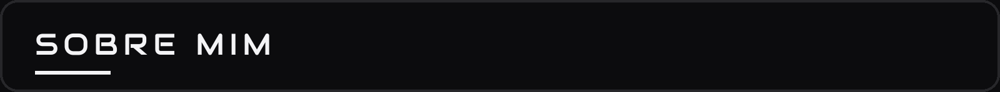</a>

<a href="#">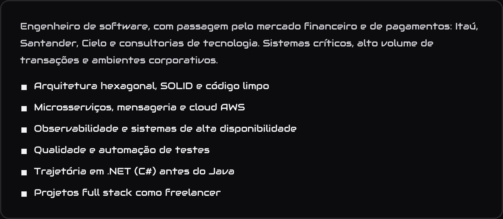</a>

 

<a href="#">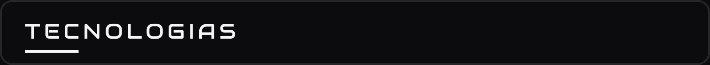</a>

<table>
  <tr>
    <td width="50%" valign="top"><a href="#">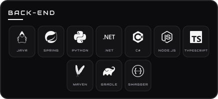</a></td>
    <td width="50%" valign="top"><a href="#">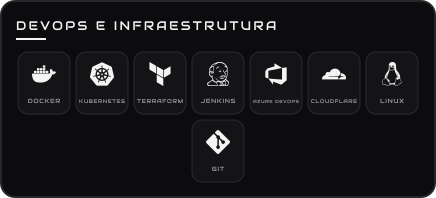</a></td>
  </tr>
  <tr>
    <td width="50%" valign="top"><a href="#">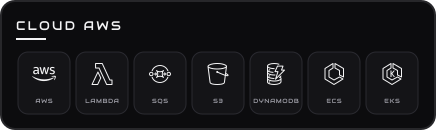</a></td>
    <td width="50%" valign="top"><a href="#">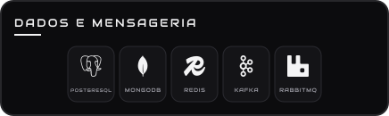</a></td>
  </tr>
  <tr>
    <td width="50%" valign="top"><a href="#">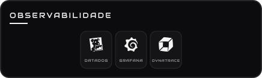</a></td>
    <td width="50%" valign="top"><a href="#">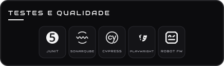</a></td>
  </tr>
  <tr>
    <td width="50%" valign="top"><a href="#">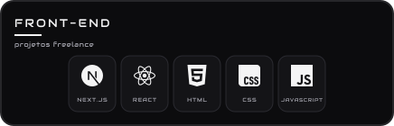</a></td>
    <td width="50%" valign="top"><a href="#">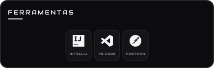</a></td>
  </tr>
</table>

 

<a href="#">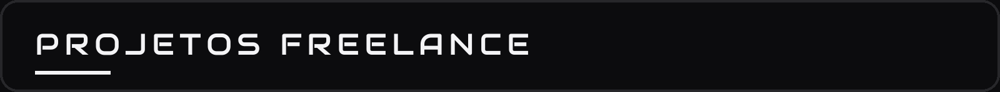</a>

<table>
  <tr>
    <td width="50%" valign="top">
      <a href="https://assistenciagm.com">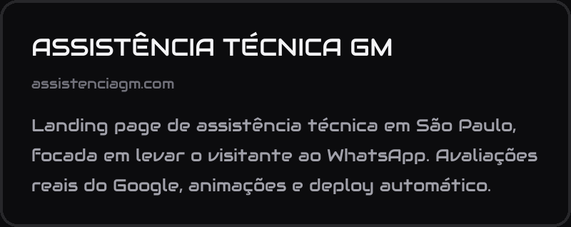</a>
       <a href="#">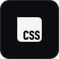</a>  <a href="#">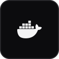</a> 
    </td>
    <td width="50%" valign="top">
      <a href="https://egotv.net">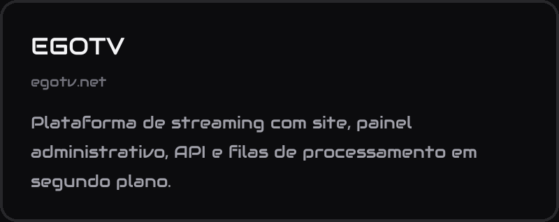</a>
       <a href="#">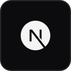</a>    
    </td>
  </tr>
  <tr>
    <td width="50%" valign="top">
      <a href="#">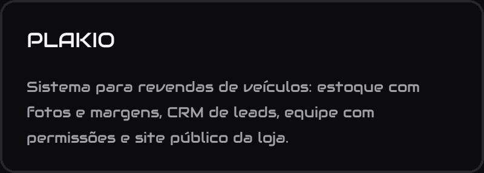</a>
         
    </td>
    <td width="50%" valign="top">
      
         
    </td>
  </tr>
</table>

 

<a href="#">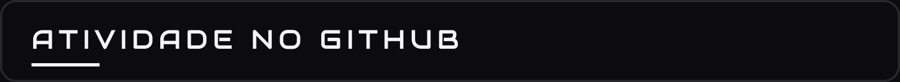</a>

  

  <a href="#"><picture>
    <source media="(prefers-color-scheme: dark)" srcset="https://raw.githubusercontent.com/nakaodeveloper/nakaodeveloper/output/snake-dark.svg">
    <source media="(prefers-color-scheme: light)" srcset="https://raw.githubusercontent.com/nakaodeveloper/nakaodeveloper/output/snake.svg">
    
  </picture></a>

